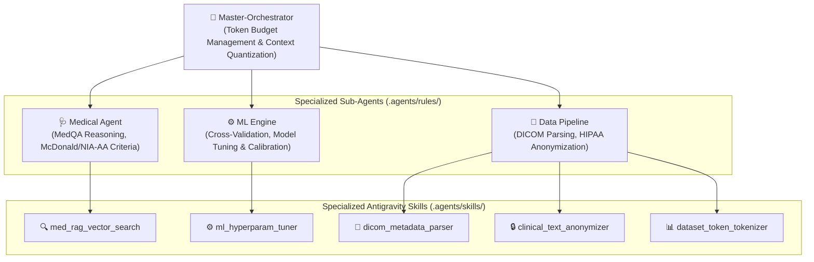

# 🧠 NeuroAI: Multimodal Neurological & Autoimmune Diagnostic Platform

[](https://www.python.org/)
[](https://obsidian.md/)
[](file:///.agents/skills)
[](file:///README.md)
[](file:///README.md)

---

## 🌐 Navigation / Выбор Языка
- [English Documentation](#-english-documentation)
- [Русская Документация](#-русская-документация)

---

# 🇬🇧 English Documentation

## 📌 Executive Summary
**NeuroAI** is a clinical-grade artificial intelligence platform and medical research ecosystem designed for differential diagnosis, risk stratification, and biomarker modeling across six major neurodegenerative and autoimmune central nervous system disorders:
1. **Healthy Normal Control** (Age-appropriate baseline)
2. **Mild Cognitive Impairment (MCI)** (Prodromal Alzheimer's Disease)
3. **Alzheimer's Disease (AD)** (Clinical dementia stage)
4. **Parkinson's Disease (PD)** (Nigrostriatal loss & motor triad)
5. **Multiple Sclerosis (MS)** (RRMS & progressive demyelinating states)
6. **Amyotrophic Lateral Sclerosis (ALS)** (Upper & lower motor neuron degeneration)

The platform incorporates:
- **Interactive Multimodal Web Studio**: Real-time evaluation of patient survey scores and quantitative MRI metrics.
- **Obsidian Dual-Graph Knowledge Base**: 34 deeply researched notes structured into two independent connected graphs (`docs/ru/` and `docs/en/`).
- **3-Tier Antigravity Agent Architecture**: Managed token budgets, role separation (`Master-Orchestrator`, `Medical Agent`, `ML Engine`, `Data Pipeline`).
- **5 Specialized Clinical & ML Skills**: Automated RAG search, non-binary DICOM parsing, clinical text anonymization (HIPAA/GDPR/152-FZ), hyperparameter grid tuning, and dataset tokenization.

---

## 🏛️ 3-Tier Sub-Agent Architecture

To prevent context exhaustion and eliminate redundant token spend during complex reasoning, NeuroAI implements an explicit 3-tier sub-agent delegation model:



### Sub-Agent Roles and Rules (`.agents/rules/`):
- `00_orchestrator.md`: Enforces prompt compression, routing, and context quantization.
- `01_medical_agent.md`: Enforces validated diagnostic guidelines (McDonald 2017, NIA-AA AT(N), MDS-UPDRS, Gold Coast 2020) and zero clinical hallucination.
- `02_ml_engine.md`: Enforces strict data segregation, stratified 5-fold cross-validation, and probability calibration.
- `03_data_pipeline.md`: Enforces mandatory PII de-identification, non-binary DICOM header extraction, and token pre-computation.

---

## 🛠️ Specialized Clinical & ML Skills (`.agents/skills/`)

| Skill Name | Purpose | Token & Pipeline Optimization | CLI Command |
| :--- | :--- | :--- | :--- |
| **`med_rag_vector_search`** | Semantic vector search over medical corpus and guidelines. | Returns targeted text chunks, eliminating raw paper dumps into LLM context. | `python .agents/skills/med_rag_vector_search/scripts/search.py --query "McDonald" --top_k 2` |
| **`dicom_metadata_parser`** | High-speed DICOM header extractor (`pydicom`). | Extracts clinical tags (Age, Modality, Field, RepetitionTime) without loading heavy pixel arrays. | `python .agents/skills/dicom_metadata_parser/scripts/parse_dicom.py --dir path/to/dicom/` |
| **`clinical_text_anonymizer`** | De-identifies patient records (HIPAA Safe Harbor & 152-FZ). | Strips names, dates, phones, and passport numbers before LLM processing, removing noisy tokens. | `python .agents/skills/clinical_text_anonymizer/scripts/anonymize.py --text "..."` |
| **`ml_hyperparam_tuner`** | YAML-driven automated hyperparameter grid search. | Runs systematic cross-validation without rewriting Python training scripts. | `python .agents/skills/ml_hyperparam_tuner/scripts/tuner.py --config config/hyperparams.yaml` |
| **`dataset_token_tokenizer`** | BPE token counter and context optimizer (`tiktoken`). | Pre-computes batch boundaries and tokens to avoid exceeding LLM context windows. | `python .agents/skills/dataset_token_tokenizer/scripts/tokenize_dataset.py --text "..."` |

---

## 🔬 Scientific Literature Synthesis: Multimodal Detection

### 1. Alzheimer's Disease & Mild Cognitive Impairment (MCI)
- **AT(N) Biomarker Framework (Jack et al., 2018; NIA-AA)**:
  - **A (Amyloid)**: Decreased CSF Aβ42 or Aβ42/Aβ40 ratio; florbetapir cortical PET uptake.
  - **T (Tau)**: Elevated CSF/plasma phosphorylated tau (p-tau181, p-tau217).
  - **N (Neurodegeneration)**: Medial Temporal Lobe Atrophy (MTA / Scheltens scale 0–4), automated bilateral hippocampal volumetry (<3000 mm³ vs >4000 mm³ normal), compensatory ventriculomegaly (VBR > 0.08).
- **Cognitive Screening Thresholds**: MMSE (24–27 MCI, <24 Dementia); MoCA (<26 detects subtle executive dysfunction).

### 2. Parkinson's Disease (PD)
- **MDS Clinical Diagnostic Criteria (Postuma et al., 2015)**:
  - Essential criterion: Bradykinesia combined with resting tremor (4–6 Hz) and/or cogwheel rigidity.
- **Radiological Biomarkers**:
  - High-field (3T) Susceptibility-Weighted Imaging (SWI) demonstrates loss of the **swallow-tail sign** in nigrosome-1 (dorsolateral substantia nigra).
  - DaTscan (123I-ioflupane SPECT) shows asymmetric putaminal dopaminergic transporter reduction.

### 3. Multiple Sclerosis (MS)
- **2017 McDonald Criteria (Thompson et al., Lancet Neurol)**:
  - **Dissemination in Space (DIS)**: ≥1 T2-hyperintense lesion in ≥2 of 4 areas (periventricular, cortical/juxtacortical, infratentorial, spinal cord).
  - **Dissemination in Time (DIT)**: Simultaneous presence of gadolinium-enhancing and non-enhancing lesions, or **CSF-restricted oligoclonal IgG bands (Pattern 2)**.
  - Radiological signatures: Dawson's fingers along medullary venules, central vein sign (CVS).

### 4. Amyotrophic Lateral Sclerosis (ALS)
- **Gold Coast Criteria (Hannaford et al., 2021)**: Progressive motor impairment with combined upper motor neuron (UMN) and lower motor neuron (LMN) signs in ≥1 body region.
- **Functional Score**: ALSFRS-R (0 to 48 points; ΔFS rate of decline predicts survival).
- **Fluid & Imaging**: Massive elevation of Neurofilament Light chain (NfL) in CSF/plasma; "motor band sign" (precentral gyrus hypointensity on T2*/SWI).

---

## 🚀 Quick Start

### 1. Installation
```bash
git clone https://github.com/airwar31/neuro-AI.git
cd neuro-AI
pip install -r requirements.txt
```

### 2. Run Diagnostic Studio
```bash
# Windows
start.bat

# Linux / macOS
bash start.sh
```
Open browser at: `http://127.0.0.1:5060`

---

## 🔒 Copyright Notice
Copyright (c) Danila (airwar31). All rights reserved.  
Unauthorized distribution or commercial exploitation is strictly prohibited.

---

# 🇷🇺 Русская Документация

## 📌 Архитектура и Инструментарий NeuroAI
Платформа **NeuroAI** объединяет алгоритмы машинного обучения, клиническую дифференциальную диагностику и экосистему скиллов Google Antigravity:

### 1. Трехуровневая Иерархия Агентов
- **👑 Master-Orchestrator**: Контроль бюджета токенов, квантование контекста, декомпозиция задач.
- **🩺 Medical Agent**: Экспертная оценка по критериям McDonald 2017, NIA-AA AT(N), MDS-UPDRS.
- **⚙️ ML Engine**: Кросс-валидация (Stratified 5-Fold), тюнинг гиперпараметров, калибровка вероятностей.
- **🔄 Data Pipeline**: Парсинг заголовков DICOM, деидентификация EMR/ПДн (HIPAA, 152-ФЗ), токенизация.

### 2. Набор Специализированных Скиллов (`.agents/skills/`)
1. **`med_rag_vector_search`**: Семантический поиск по медицинским руководствам и статьям без перегрузки контекста.
2. **`dicom_metadata_parser`**: Мгновенное чтение метаданных DICOM без загрузки тяжелых массивов пикселей.
3. **`clinical_text_anonymizer`**: Очистка персональных данных пациентов (ФИО, даты, телефоны, паспорта).
4. **`ml_hyperparam_tuner`**: Автоматический подбор гиперпараметров по YAML-конфигам.
5. **`dataset_token_tokenizer`**: Подсчет токенов и расчет размера батчей через BPE (`tiktoken`).

---

## 🔒 Авторские Права
Copyright (c) Danila (airwar31). Все права защищены.
